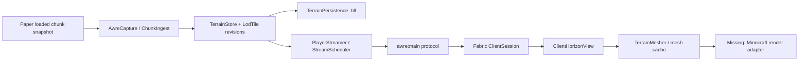
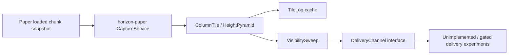

# Architecture Overview

## Two related but distinct paths

### AWRE modded-client path

Evidence: `awre-paper/src/main/java/dev/awre/paper/`, `awre-protocol/src/main/java/dev/awre/protocol/`, `awre-stream/src/main/java/dev/awre/stream/`, and `awre-fabric/src/main/java/dev/awre/fabric/`.

- `awre-paper`: Paper plugin lifecycle, capture, config, commands, world terrain and streaming orchestration.
- `horizon-core`: dependency-free data models, LOD planning, terrain tile codec/store, meshing, persistence primitives, queue and visibility analysis.
- `awre-protocol`: dependency-free protocol sessions, bounded frames/fragments, palette and tile messages, validation and revisions.
- `awre-stream`: pure-Java integration of ingest, persistence, scheduling, client-side tile selection/meshing cache and synthetic test terrain.
- `awre-fabric`: separate Loom build; networking/event adapter. It currently creates and updates `ClientHorizonView` but does not draw the meshes.

### Legacy vanilla-client research path

This path is implemented separately under `horizon-paper` and the shared `horizon-core` legacy classes. `docs/PROTOCOL.md` and `docs/EXPERIMENTS.md` describe candidate vanilla mechanisms and experiments; they do not establish that vanilla clients render custom geometry beyond their normal view distance.

## Data and thread boundaries

- Paper event handlers should capture immutable snapshots only from eligible already-loaded chunks; do not force chunk loads or generation to populate distant terrain.
- Pure-Java terrain analysis, encoding, persistence, scheduling and mesh generation are intended to stay independent of Bukkit and Minecraft client classes.
- Fabric event/network glue adapts Minecraft lifecycle and custom payloads to the pure-Java protocol/view.
- The renderer must own GPU resources on the correct render thread and release them on world change, disconnect, and client shutdown. This adapter is the current implementation gap.
- Tile keys include world UUID halves, dimension, tile coordinates and LOD; received revisions prevent older payloads replacing newer data. Confirm actual implementation/tests before changing these contracts.

## Build boundary

Root `settings.gradle.kts` includes `horizon-core`, `horizon-paper`, `awre-protocol`, `awre-stream`, and `awre-paper`. `awre-fabric` intentionally has its own Loom build and includes pure-Java source directories directly. CI builds root modules and Fabric separately.

## Representation limits

The AWRE tile mesher currently operates on a surface-oriented terrain tile. This is not a full voxel representation: caves, overhang undersides, detailed structures, foliage, and block-entity geometry are not represented faithfully by a single surface tile. Treat richer representations as future work, not current capabilities.
